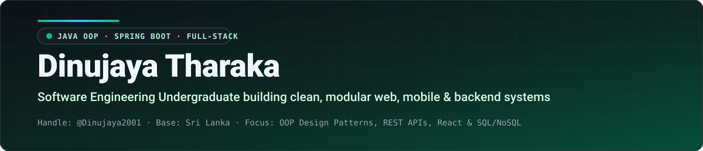
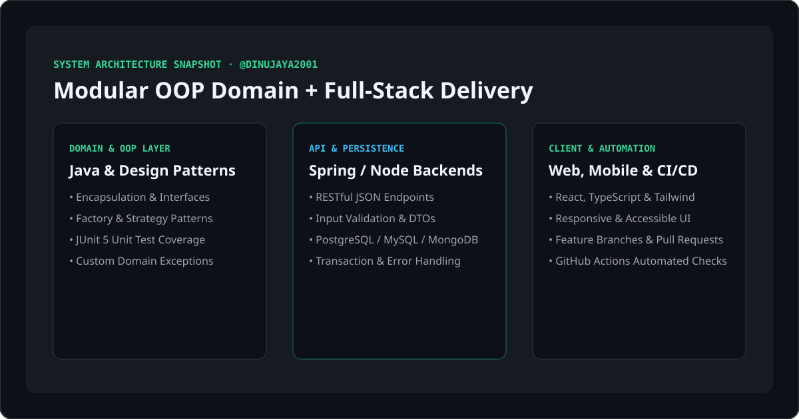

 

---

## About Me

I am **Dinujaya Tharaka** (`@Dinujaya2001`), a Software Engineering undergraduate and full-stack developer focused on building clean, maintainable software from domain model to user interface. My work centers on **Object-Oriented Programming (OOP) in Java**, structured backend APIs, responsive frontend interfaces, and disciplined Git workflows.

- **Current Focus:** Deepening Java OOP design patterns, JUnit testing, and full-stack REST API architecture.
- **Open To:** Software Engineering Internships, Junior Full-Stack / Backend roles, and collaborative open-source builds.
- **Engineering Principles:** Clear boundaries between UI, service/domain logic, and data persistence; small atomic commits; documented APIs.

---

## Core Skills & Tech Stack

| Layer | Technologies | How I Apply Them |
| :--- | :--- | :--- |
| **Backend & OOP** | `Java` `Spring Boot` `Node.js` `Express` | Domain modeling, interfaces/polymorphism, validation, REST APIs, auth & error handling |
| **Frontend & UI** | `React` `TypeScript` `JavaScript` `HTML5` `CSS3` `Tailwind CSS` | Component-driven UIs, state management, responsive layouts, accessible forms |
| **Databases** | `PostgreSQL` `MySQL` `MongoDB` | Relational schema design, indexing/joins, document modeling, query optimization |
| **Tooling & DevOps** | `Git` `GitHub Actions` `Docker` `Linux` `JUnit` | Feature branching, pull requests, automated CI checks, containerized local setups |

---

## Highlighted Projects

### 1. OOP Task & Workflow Engine (`java-oop-task-engine`)
Modular backend service demonstrating **encapsulation, polymorphism, strategy/factory patterns, and JUnit 5 unit tests** for rule-based task assignment and audit logging.
- **Stack:** `Java` · `Spring Boot` · `JUnit 5` · `PostgreSQL` · `Docker`
- **Links:** [Repository](https://github.com/Dinujaya2001/java-oop-task-engine) · [Live Demo](https://your-demo-url.example.com/tasks) · [API Docs](https://your-demo-url.example.com/tasks/docs)

### 2. Full-Stack Inventory & Order Hub (`fullstack-inventory-hub`)
End-to-end web application with role-based access, real-time stock updates, and clean REST endpoints backed by relational persistence.
- **Stack:** `React` · `TypeScript` · `Tailwind CSS` · `Node.js` · `PostgreSQL`
- **Links:** [Repository](https://github.com/Dinujaya2001/fullstack-inventory-hub) · [Live Demo](https://your-demo-url.example.com/inventory) · [API Docs](https://your-demo-url.example.com/inventory/docs)

### 3. Developer Portfolio & Component Kit (`web-ui-component-kit`)
Accessible, responsive frontend components and layout patterns built with semantic HTML, modern CSS, and interactive state handling.
- **Stack:** `HTML5` · `CSS3` · `JavaScript` · `React`
- **Links:** [Repository](https://github.com/Dinujaya2001/web-ui-component-kit) · [Live Demo](https://your-demo-url.example.com/ui-kit)

 

  

---

## Experience & Engineering Practice

- **Full-Stack & OOP Project Builder (Academic & Independent · Ongoing)**
  - Designed multi-layer applications separating presentation, business logic, and database access.
  - Practiced feature-branch workflows (`feat/...`, `fix/...`, `chore/...`), pull requests, and automated CI checks rather than committing directly to `main`.
  - Authored clear setup guides, endpoint documentation, and unit tests for core domain behaviors.

---

##    GitHub Stats

  
    
  

 

  

 

  

---

##    GitHub Trophies

  

---

## Contribution & Activity Summary

<!-- CONTRIBUTION_SUMMARY:START -->
- **Account:** `@Dinujaya2001` (Dinujaya Tharaka)
- **Primary Languages:** Java, TypeScript / JavaScript, HTML & CSS, SQL
- **Workflow Focus:** Consistent commits, feature branches, documented PRs, and automated workflow checks
<!-- CONTRIBUTION_SUMMARY:END -->

---

## Latest Blog & Engineering Notes

<!-- BLOG_POSTS:START -->
- [Building Clean OOP Domain Models in Java Before Adding Frameworks](https://github.com/Dinujaya2001) — *Notes on encapsulation, interfaces, and testability*
- [Structuring REST APIs and Error Responses for Full-Stack Apps](https://github.com/Dinujaya2001) — *Practical patterns for predictable client-server contracts*
<!-- BLOG_POSTS:END -->

---

## Contact & Résumé

- **Email:** [dinujayatharaka2001@gmail.com](mailto:dinujayatharaka2001@gmail.com)
- **LinkedIn:** [linkedin.com/in/your-linkedin-username](https://www.linkedin.com/in/your-linkedin-username/)
- **GitHub:** [github.com/Dinujaya2001](https://github.com/Dinujaya2001)
- **Résumé / CV:** [Download Latest CV](./assets/Dinujaya_Tharaka_CV.pdf)

---

  Built with clean code & continuous commits · <strong>@Dinujaya2001</strong>

